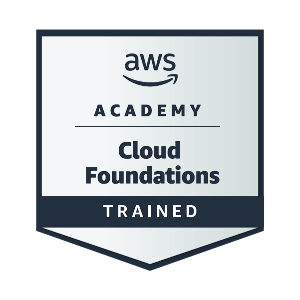

<!-- ==================== HEADER ==================== -->

 

  

  

<!-- ==================== MAIN CONTENT ==================== -->

## About Me

I am a **Computer Engineering undergraduate** at the **University of Sri Jayewardenepura**, pursuing a minor in **High Performance Computing (HPC)**.

My interests include **Software Engineering, Full Stack Development, Artificial Intelligence, IoT Systems, Mobile Development, Cloud Computing, and Parallel Computing**. I enjoy exploring how hardware and software work together to solve practical problems.

Through academic and personal projects, I am building experience in:

- Web and mobile application development
- Embedded systems and IoT monitoring
- Cloud-integrated applications using AWS
- C++ programming and algorithm implementation
- Database-driven applications

### High Performance Computing

As part of my HPC studies, my project focuses on **load-balanced parallel Graph Neural Network (GNN) inference for large collections of small graphs**.

The project aims to develop a **C/C++ inference engine**, parallelise it using **OpenMP**, and compare scheduling strategies to improve workload distribution across CPU cores.

**Areas of interest:** Parallel Programming · Multicore Computing · Load Balancing · Performance Evaluation

### Open To

- Software Engineering Internships
- Full Stack and Mobile Development Opportunities
- AI / ML and IoT Projects
- Cloud & DevOps Learning Opportunities
- Open Source Contributions
- HPC and Research Collaborations

---

## Featured Projects

<!--
ADD A PROJECT:
Copy a complete 
...
 block.
Update its title, description, table, and repository link.
Use 
 to make the project collapsed initially.
-->

<b>TropicStore — Smart Fruit Ripening Chamber</b>

 

An **IoT-based smart fruit ripening chamber** designed to provide an automated and controlled environment for fruit ripening.

The system uses an ESP32 to monitor environmental conditions and control actuators, with MQTT, AWS IoT, and a dedicated mobile application supporting remote monitoring and control.

| Area | Details |
| :--- | :--- |
| Domain | Embedded Systems · IoT · Cloud Integration |
| Core technologies | ESP32 · MQTT · AWS IoT |
| Chamber controls | Exhaust fan, servo-operated ventilation door, mist maker, and lighting |
| Objective | Reduce continuous manual monitoring through automated chamber control |

<!--
Add when ready:
**My contribution:** Describe your firmware, hardware, app, or cloud work.
-->

 

<b>RescueMesh — AI-Assisted Flood Emergency Response</b>

 

A flood emergency response project combining a **mobile application, registration website, administrative dashboard, and backend services** to support rescue-request management.

The software processes SOS messages, associates requests with registered household information, predicts message severity using **machine learning**, and uses **Google Gemini** for concise summaries and suggested responses.

**Recognition:** SLIOT 2026 — **Semifinalist**

### Key Features

- **SOS Processing:** Receives alerts, checks active device registration, and checks for repeated messages within a 60-second window.
- **Incident Context:** Associates requests with registered household details, family size, and home coordinates.
- **ML-Based Severity Classification:** Uses **TF-IDF text features** and a **Random Forest classifier with 100 decision trees**, served through a Flask API.
- **Emergency Button Handling:** Assigns predefined severity levels to critical and general button alerts.
- **AI Summaries:** Uses **Gemini 2.5 Flash** to summarise longer messages, with instructions to retain Sinhala for Sinhala requests.
- **Suggested Responses:** Generates short, context-aware reply suggestions for operators.
- **Gateway Reply Queue:** Stores submitted responses for gateway retrieval and tracks gateway-reported send status.
- **Incident History:** Maintains alert records, response history, timestamps, and handling status in Cloud Firestore.

### Technology Stack

| Component | Technologies |
| :--- | :--- |
| Mobile Application | Flutter · Dart |
| Backend | Node.js · Express.js |
| Database | Firebase Cloud Firestore |
| Severity Classification | Python · scikit-learn · TF-IDF · Random Forest |
| ML Prediction API | Flask |
| Summaries & Reply Suggestions | Google Gemini 2.5 Flash |

### Repositories

| Component | Repository |
| :--- | :--- |
| **Mobile Application** | [View App](https://github.com/VimukthiUdeshan/Rescue-Mesh) |
| **Registration Website** | [View Registration Site](https://github.com/VimukthiUdeshan/Rescue-Mesh-Registration-Site) |
| **Administrative Dashboard** | [View Dashboard](https://github.com/VimukthiUdeshan/Rescue-Mesh-Official-Dashboard) |
| **Backend** | [View Backend](https://github.com/VimukthiUdeshan/Rescue-Mesh-Backend) |
| **ML Model & Prediction API** | Repository link coming soon |

<!--
ADD YOUR ML REPOSITORY:
Replace "Repository link coming soon" in the table above with:

[View ML Repository](YOUR_ML_REPOSITORY_URL)
-->

### Development Status

Current work covers the **software and AI/ML components**, including backend endpoints for gateway communication. Integration and end-to-end testing with the team's **IoT hardware** are planned.

<!--
FUTURE UPDATES:
- Add screenshots or a demo video.
- Add your specific contributions within the team.
- Update the IoT integration status after testing.
- Add model evaluation results once measured on held-out data.
-->

 

<b>AI Business Automation Platform — Beauty of Cloud 2.0</b>

 

A cloud solution concept and dashboard demo developed by **Team VR Force** for **Beauty of Cloud 2.0**, achieving **1st Runner-Up**.

The proposed platform enables businesses to create task-specific AI assistants that use authorised company information and approved tools to handle requests such as order cancellations, appointment bookings, customer complaints, and document preparation.

The design focuses on keeping each business’s data separate, requiring human approval for sensitive actions, maintaining audit records, and controlling usage costs.

| Area | Details |
| :--- | :--- |
| Team | VR Force |
| Competition | Beauty of Cloud 2.0 |
| Achievement | 1st Runner-Up |
| Deliverables | Cloud architecture proposal and dashboard demo |
| Demo frontend | React · TypeScript |
| Proposed cloud platform | Amazon Web Services (AWS) |
| Architecture components | Amazon Bedrock · Lambda · API Gateway · Cognito · S3 · CloudFront · SQS · Step Functions · DynamoDB · Aurora PostgreSQL |
| Design priorities | Tenant isolation · Human approval · Auditability · Cost control |

### Dashboard Demo

The dashboard includes interfaces for an operational overview, knowledge management, conversations, orders, analytics, and security settings.

### Proposed Architecture

- **AI assistance:** Use Amazon Bedrock with retrieval of relevant, authorised business documents.
- **Controlled actions:** Validate permissions and require approval before sensitive operations.
- **Workflow management:** Use SQS and Step Functions for queued tasks and approval workflows.
- **Business data isolation:** Apply tenant-aware access controls across application and storage layers.
- **Operational visibility:** Track task progress, usage, spending, and action records.

**Project scope:** A competition prototype demonstrating the dashboard and proposed architecture; the full production platform was not implemented.

<!--
ADD YOUR REPOSITORY:
Replace "Repository: Coming soon." above with the following line,
then replace YOUR_REPOSITORY_URL with your GitHub repository link.

[View Repository →](YOUR_REPOSITORY_URL)
-->

---

## Technical Skills

### Programming Languages

  

### Web Development & Databases

  

### Mobile App Development

  

### Cloud & Containers

  

### Development & Design Tools

  

### Currently Exploring

  
  
  

---

## Volunteering & Extracurricular Experience

<!--
ADD EXPERIENCE:
Copy a complete 
...
 block.
Update the club, event, role, and contributions.
Use 
 to expand a role by default.
-->

<b>CGS — Career Xplore 2025 | Marketing Team Member</b>

 

- Contributed to event promotion as a member of the marketing team.
- Designed promotional flyers and banners for the event.

**Skills:** Graphic Design · Visual Communication · Teamwork

 

<b>Nexus — Dark Laugh | Marketing Team Member</b>

 

- Supported event publicity as a member of the marketing team.
- Created flyers for promotional use.

**Skills:** Graphic Design · Visual Communication · Teamwork

 

<b>IESL JIY 2025 | Editorial Pillar Member</b>

 

- Served as a member of the Editorial Pillar.

<!-- Add your specific editorial contributions here when ready. -->

---

## Creative Skills

Alongside my technical work, I enjoy visual communication and creative media production.

- **Graphic Design:** Promotional flyers, banners, and event visuals
- **Video Editing:** Editing and assembling video content
- **Content Creation:** Developing visual and written content

---

## Competitions & Achievements

<!--
ADD AN ACHIEVEMENT:
Copy a table row and update the competition, result, and details.
-->

| Competition | Achievement | Project / Organiser |
| :--- | :--- | :--- |
| **SLIOT 2026** | **Semifinalist** | RescueMesh |
| **Beauty of Cloud 2.0** | **1st Runner-Up** | IEEE, University of Sri Jayewardenepura |

---

## Certifications & Badges

### AWS Academy Graduate - Cloud Foundations - Training Badge

**Issued by:** Amazon Web Services Training and Certification

[Verify Badge on Credly →](https://www.credly.com/go/rAV5W1Ypo425QERsXvnjUA)

---

## Current Focus

<ul align="left">
  <li>Strengthening my <strong>React and application development</strong> skills.</li>
  <li>Expanding my knowledge of <strong>AWS and cloud computing</strong>.</li>
  <li>Building and documenting <strong>IoT and embedded systems projects</strong>.</li>
  <li>Exploring <strong>OpenMP, parallel GNN inference, and load balancing</strong> through my HPC project.</li>
</ul>

---

## GitHub Activity

  

---

## Connect With Me

Interested in discussing software, cloud computing, IoT, or parallel computing? Get in touch.

  
  

**Email:** [vimukthiudeshan2018@gmail.com](mailto:vimukthiudeshan2018@gmail.com)

<!-- ==================== FOOTER ==================== -->

