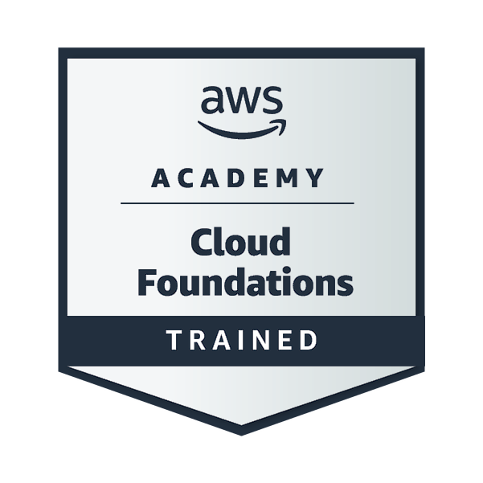
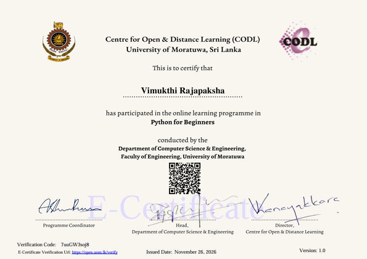

<!-- ==================== HEADER ==================== -->

 

  
  

  
  
  

 

<!-- ==================== MAIN CONTENT ==================== -->

## About Me

I am a **Computer Engineering undergraduate** at the **University of Sri Jayewardenepura**, pursuing a minor in **High Performance Computing (HPC)**.

My interests include **Software Engineering, Full Stack Development, Artificial Intelligence, IoT Systems, Mobile Development, Cloud Computing, and Parallel Computing**. I enjoy exploring how hardware and software work together to solve practical problems.

Through academic and personal projects, I am building experience in:

- Web and mobile application development
- Embedded systems and IoT monitoring
- Cloud-integrated applications using AWS
- C++ programming and algorithm implementation
- Database-driven applications

### Open To

- Software Engineering Internships
- Full Stack and Mobile Development Opportunities
- AI / ML and IoT Projects
- Cloud & DevOps Learning Opportunities
- Open Source Contributions
- HPC and Research Collaborations

---

## Featured Projects

<!--
ADD A PROJECT:
Copy a complete 
...
 block.
Update its title, description, table, and repository link.
Use 
 to make the project collapsed initially.
-->

<b>TropicStore — Smart Fruit Ripening Chamber</b>

 

An **IoT-based smart fruit ripening chamber** designed to provide an automated and controlled environment for fruit ripening.

The system uses an ESP32 to monitor environmental conditions and control actuators, with MQTT, AWS IoT, and a dedicated mobile application supporting remote monitoring and control.

| Area | Details |
| :--- | :--- |
| Domain | Embedded Systems · IoT · Cloud Integration |
| Core technologies | ESP32 · MQTT · AWS IoT |
| Chamber controls | Exhaust fan, servo-operated ventilation door, mist maker, and lighting |
| Objective | Reduce continuous manual monitoring through automated chamber control |

<!--
Add when ready:
**My contribution:** Describe your firmware, hardware, app, or cloud work.
-->

<b>StuDZ — University Student Companion App</b>

 

A cross-platform **mobile app for engineering undergraduates** that brings timetables, attendance, exams, GPA, notes and a campus community into one place. It is built around the **Faculty of Engineering Student Guide 2026**, so the module, lecturer and elective data is built into the app.

| Area | Details |
| :--- | :--- |
| Domain | Mobile Development · Backend & Security · Gemini API Integration |
| Core technologies | React Native · Expo · TypeScript · Supabase · Gemini API |
| Status | **In active development** · Android builds via EAS |

### Key Features

- **Timetable Extraction with Gemini API:** Students upload a PDF or photo of their timetable. A Supabase Edge Function sends it to the Gemini API, which returns structured JSON. Lecturers are matched against the staff directory, and a review screen lets students correct every entry before it is saved.
- **Semester Setup:** Compulsory, elective and optional modules, with elective credit groups taken from the handbook.
- **Hybrid Attendance:** Online participation limits per module, labs attended in person, and adaptive notification polls after each class.
- **Live Class Countdown:** A circular progress ring during lectures, with a one-tap join link for online sessions.
- **Exams & Revision Tracking:** Exam countdowns with per-module syllabus coverage.
- **GPA Tools:** The handbook grading scale, re-sit and repeat caps, class honours, and past-semester grade entry.
- **Notes:** Typed, handwritten (SVG canvas) and photo notes organised by module and topic, with sharing to the community.
- **Community & Groups:** Posts with photos, comments and reporting, plus private invite-code groups with realtime chat.
- **Account Security:** University-email registration enforced by database triggers, email confirmation, Row Level Security, rate limits, and automatic hiding of repeatedly reported content.
- **Admin Website:** A web panel for the module catalog, lecturers, academic calendar, announcements, moderation and users.

### Technology Stack

| Component | Technologies |
| :--- | :--- |
| Mobile Application | React Native · Expo (SDK 54) · TypeScript · Expo Router |
| Backend & Database | Supabase Auth · PostgreSQL · Row Level Security · Realtime · Storage |
| Serverless | Supabase Edge Functions (Deno) |
| Document Understanding | Gemini API (image and PDF input, structured JSON output) |
| Graphics & Device | react-native-svg · expo-notifications · expo-image-picker |
| Build & Release | EAS Build (Android APK) |
| Admin Panel | HTML · CSS · JavaScript |

<!--

-->

<b>RescueMesh — AI-Assisted Flood Emergency Response</b>

 

A flood emergency response project combining a **mobile application, registration website, administrative dashboard, and backend services** to support rescue-request management.

The software processes SOS messages, associates requests with registered household information, predicts message severity using **machine learning**, and uses **Google Gemini** for concise summaries and suggested responses.

**Recognition:** SLIOT 2026 — **Semifinalist**

### Key Features

- **SOS Processing:** Receives alerts, checks active device registration, and checks for repeated messages within a 60-second window.
- **Incident Context:** Associates requests with registered household details, family size, and home coordinates.
- **ML-Based Severity Classification:** Uses **TF-IDF text features** and a **Random Forest classifier with 100 decision trees**, served through a Flask API.
- **Emergency Button Handling:** Assigns predefined severity levels to critical and general button alerts.
- **AI Summaries:** Uses **Gemini 2.5 Flash** to summarise longer messages, with instructions to retain Sinhala for Sinhala requests.
- **Suggested Responses:** Generates short, context-aware reply suggestions for operators.
- **Gateway Reply Queue:** Stores submitted responses for gateway retrieval and tracks gateway-reported send status.
- **Incident History:** Maintains alert records, response history, timestamps, and handling status in Cloud Firestore.

### Technology Stack

| Component | Technologies |
| :--- | :--- |
| Mobile Application | Flutter · Dart |
| Backend | Node.js · Express.js |
| Database | Firebase Cloud Firestore |
| Severity Classification | Python · scikit-learn · TF-IDF · Random Forest |
| ML Prediction API | Flask |
| Summaries & Reply Suggestions | Google Gemini 2.5 Flash |

### Repositories

| Component | Repository |
| :--- | :--- |
| **Mobile Application** | [View App](https://github.com/VimukthiUdeshan/Rescue-Mesh) |
| **Registration Website** | [View Registration Site](https://github.com/VimukthiUdeshan/Rescue-Mesh-Registration-Site) |
| **Administrative Dashboard** | [View Dashboard](https://github.com/VimukthiUdeshan/Rescue-Mesh-Official-Dashboard) |
| **Backend** | [View Backend](https://github.com/VimukthiUdeshan/Rescue-Mesh-Backend) |
| **ML Model & Prediction API** | Repository link coming soon |

<!--
ADD YOUR ML REPOSITORY:
Replace "Repository link coming soon" in the table above with:

[View ML Repository](YOUR_ML_REPOSITORY_URL)
-->

<!--
FUTURE UPDATES:
- Add screenshots or a demo video.
- Add your specific contributions within the team.
- Update the IoT integration status after testing.
- Add model evaluation results once measured on held-out data.
-->

<b>AI Business Automation Platform — Beauty of Cloud 2.0</b>

 

A cloud solution concept and dashboard demo developed by **Team VR Force** for **Beauty of Cloud 2.0**, achieving **1st Runner-Up**.

The proposed platform enables businesses to create task-specific AI assistants that use authorised company information and approved tools to handle requests such as order cancellations, appointment bookings, customer complaints, and document preparation.

The design focuses on keeping each business’s data separate, requiring human approval for sensitive actions, maintaining audit records, and controlling usage costs.

| Area | Details |
| :--- | :--- |
| Team | VR Force |
| Competition | Beauty of Cloud 2.0 |
| Achievement | 1st Runner-Up |
| Deliverables | Cloud architecture proposal and dashboard demo |
| Demo frontend | React · TypeScript |
| Proposed cloud platform | Amazon Web Services (AWS) |
| Architecture components | Amazon Bedrock · Lambda · API Gateway · Cognito · S3 · CloudFront · SQS · Step Functions · DynamoDB · Aurora PostgreSQL |
| Design priorities | Tenant isolation · Human approval · Auditability · Cost control |

### Dashboard Demo

The dashboard includes interfaces for an operational overview, knowledge management, conversations, orders, analytics, and security settings.

### Proposed Architecture

- **AI assistance:** Use Amazon Bedrock with retrieval of relevant, authorised business documents.
- **Controlled actions:** Validate permissions and require approval before sensitive operations.
- **Workflow management:** Use SQS and Step Functions for queued tasks and approval workflows.
- **Business data isolation:** Apply tenant-aware access controls across application and storage layers.
- **Operational visibility:** Track task progress, usage, spending, and action records.

**Project scope:** A competition prototype demonstrating the dashboard and proposed architecture; the full production platform was not implemented.

<!--
ADD YOUR REPOSITORY:
Replace "Repository: Coming soon." above with the following line,
then replace YOUR_REPOSITORY_URL with your GitHub repository link.

[View Repository →](YOUR_REPOSITORY_URL)
-->

<b>Shelfy AI — NLP Supermarket Shopping Assistant</b>

 

A desktop chatbot designed for a supermarket entrance. Shoppers type their grocery list in plain English, and the assistant finds each item, shows its shelf location, and exports a printable PDF shopping list.

Developed for **CO3251 – Natural Language Processing** at the University of Sri Jayewardenepura.

### Key Features

- **NLP Item Extraction:** Uses NLTK tokenization, POS tagging, and lemmatization, with a noise-word filter, to pull grocery items out of free-form sentences.
- **Product Lookup:** Searches a database of 101 products across 18 shelf zones, using exact matching first and then fuzzy matching.
- **Typo Recovery:** Suggests close matches with one-tap *Yes / No* buttons (for example, "chokolate" → "milk chocolate").
- **PDF Shopping List:** Exports the cart with shelf locations, date, and time using ReportLab.
- **Accounts and History:** Supports email, Google, and guest sign-in, with trips saved to Firebase Realtime Database.

### Technology Stack

| Component | Technologies |
| :--- | :--- |
| Language | Python |
| NLP | NLTK · WordNet · difflib |
| Desktop GUI | CustomTkinter |
| Authentication & Storage | Firebase Auth · Realtime Database · Google OAuth2 |
| PDF Export | ReportLab |

<b>Load-Balanced Parallel GNN Inference — HPC Project</b>&nbsp;

 

A High Performance Computing project on **parallel Graph Neural Network (GNN) inference for large collections of small graphs**.

The goal is to build a **C/C++ inference engine**, parallelise it with **OpenMP**, and compare **scheduling strategies** to distribute workload evenly across CPU cores.

| Area | Details |
| :--- | :--- |
| Domain | Parallel Programming · Multicore Computing · Performance Evaluation |
| Core technologies | C/C++ · OpenMP |
| Focus | Load balancing and scheduling strategy comparison |
| Status | **In progress** |

<b>Smart Farming — AI-Assisted Crop Advisory & Soil Monitoring</b>

 

A **Flutter mobile application** that helps farmers make data-driven decisions without needing prior agricultural knowledge. It combines **live soil sensor readings, local weather data, and AI** to recommend suitable crops, identify plant problems, and answer farming questions.

Soil data is collected by an **ESP32** connected to a **pH probe sensor (0–14 pH)** and an **RS485 3-in-1 soil sensor (EC, humidity, and temperature)**, and streamed to the app through **Firebase Realtime Database** for real-time field monitoring.

### Key Features

- **Crop Recommendation:** Combines soil pH, EC, moisture, temperature, soil type, and live weather to suggest suitable crops, with manual input when no sensor is connected.
- **Live Soil Monitoring:** Animated gauges for pH, EC, soil humidity, and soil temperature, updated from the ESP32 through Firebase.
- **Plant Doctor:** Take or upload a plant photo for identification using the **PlantNet API**, with past results saved in scan history.
- **AI Assistant:** A **Google Gemini** chatbot that answers farming questions in plain language.
- **Weather Insights:** Current conditions and forecasts through the **OpenWeather API**.
- **Multilingual Support:** English, Sinhala, and Tamil.
- **Authentication:** Email and Google sign-in with Firebase Auth.

### Technology Stack

| Component | Technologies |
| :--- | :--- |
| Mobile Application | Flutter · Dart |
| Microcontroller | ESP32 |
| Sensors | pH probe sensor (0–14 pH) · RS485 3-in-1 EC, humidity, and temperature soil sensor |
| Backend & Database | Firebase Auth · Cloud Firestore · Realtime Database |
| AI & APIs | Google Gemini · PlantNet · OpenWeather |
| Crop Scoring Module | Python · Flask |

---

## Technical Skills

### Programming Languages

  

### Web, Backend & Databases

  

### Mobile App Development

  

### Cloud, Backend Services & Containers

  

### Development & Design Tools

  

### Also Worked With

  
  
  
  

---

## Volunteering & Extracurricular Experience

<!--
ADD EXPERIENCE:
Copy a complete 
...
 block.
Update the club, event, role, and contributions.
Use 
 to expand a role by default.
-->

<b>CGS — Career Xplore 2025 | Marketing Team Member</b>

 

- Contributed to event promotion as a member of the marketing team.
- Designed promotional flyers and banners for the event.

**Skills:** Graphic Design · Visual Communication · Teamwork

 

<b>Nexus — Dark Laugh | Marketing Team Member</b>

 

- Supported event publicity as a member of the marketing team.
- Created flyers for promotional use.

**Skills:** Graphic Design · Visual Communication · Teamwork

 

<b>IESL JIY 2025 | Editorial Pillar Member</b>

 

- Served as a member of the Editorial Pillar.

<!-- Add your specific editorial contributions here when ready. -->

---

## Creative Skills

Alongside my technical work, I enjoy visual communication and creative media production.

- **Graphic Design:** Promotional flyers, banners, and event visuals
- **Video Editing:** Editing and assembling video content
- **Content Creation:** Developing visual and written content

---

## Competitions & Achievements

<!--
ADD AN ACHIEVEMENT:
Copy a table row and update the competition, result, and details.
-->

| Competition | Achievement | Project / Organiser |
| :--- | :--- | :--- |
| **SLIOT 2026** | **Semifinalist** | RescueMesh |
| **Beauty of Cloud 2.0** | **1st Runner-Up** | IEEE, University of Sri Jayewardenepura |

---

## Certifications & Badges

<!--
ADD A CERTIFICATE:
Copy a complete table row (the line starting with "| <a href=...").
Update the image path, title, issuer, date, badges and verification link.
Keep image widths: 180 for square badges, 280 for landscape certificates.
-->

| Certificate | Details |
| :--- | :--- |
|  | **AWS Academy Graduate – Cloud Foundations** Issued by Amazon Web Services Training and Certification     [Verify Badge on Credly →](https://www.credly.com/go/rAV5W1Ypo425QERsXvnjUA) |
|  | **Intro to Machine Learning** Issued by Kaggle · 26 November 2026      *Certificate of Completion awarded by Kaggle for successfully completing the Intro to Machine Learning course.*  [View Certificate →](./assets/kaggle-intro-to-machine-learning.jpg) |
|  | **Python for Beginners (Participant)** Centre for Open & Distance Learning (CODL), University of Moratuwa · 26 November 2026      *E-Certificate for participating in the Python for Beginners online learning programme, conducted by the Department of Computer Science & Engineering, Faculty of Engineering, University of Moratuwa.*  **Credential ID:** `7uuGW3soj8` [Verify Certificate →](https://open.uom.lk/verify) · [Download PDF →](./assets/python-for-beginners-uom.pdf) |

<!--
KAGGLE CREDENTIAL LINK:
If you have a public Kaggle certificate URL, add it next to "View Certificate" like:
· [Verify on Kaggle →](YOUR_KAGGLE_CERTIFICATE_URL)
-->

---

## Current Focus

<ul align="left">
  <li>Strengthening my <strong>React and application development</strong> skills.</li>
  <li>Expanding my knowledge of <strong>AWS and cloud computing</strong>.</li>
  <li>Building and documenting <strong>IoT and embedded systems projects</strong>.</li>
  <li>Exploring <strong>OpenMP, parallel GNN inference, and load balancing</strong> through my HPC project.</li>
</ul>

---

## GitHub Activity
 

  

<!--

  

-->

---

## Connect With Me

Interested in discussing software, cloud computing, IoT, or parallel computing? Get in touch.

  
  
  

<!-- ==================== FOOTER ==================== -->

